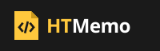
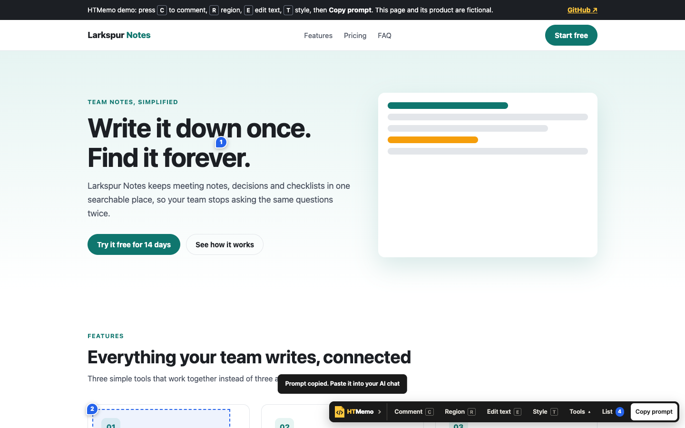

<p align="center"></p>

<p align="center"><a href="README.md">English</a> · <b>한국어</b></p>

# HTMemo

웹 페이지를 리뷰하는 Claude Code 플러그인입니다. 페이지 위에 메모를 바로 남기고, 메모 전체를 프롬프트 하나로 복사해 Claude에 붙여 넣으면 Claude가 수정합니다.

브라우저에서 페이지 위에 뜨는 도구 막대는 의존성도 서버도 없는 자바스크립트 파일 하나입니다. 요소를 클릭해 코멘트를 남기거나 드래그로 영역을 잡을 수 있고, 글자를 그 자리에서 고치거나 글자 크기·여백·색을 슬라이더로 바꿔 볼 수도 있습니다. 남긴 메모는 페이지 섹션별로 묶여 마크다운 프롬프트로 복사됩니다. 프롬프트에는 요소마다 CSS 선택자, 적용할 화면 폭, 바꿀 값이 들어갑니다.

**[데모 열기 →](https://kkjjjy1b.github.io/htmemo/demo/)**



## 설치 (Claude Code 플러그인)

Claude Code에서 아래 명령 두 줄을 실행합니다.

```text
/plugin marketplace add kkjjjy1b/htmemo
/plugin install htmemo
```

등록한 다른 마켓플레이스에도 이름이 `htmemo`인 플러그인이 있으면 `/plugin install htmemo@htmemo`로 설치합니다. Claude Code가 다시 시작하라고 하면 다시 시작합니다. 나중에 업데이트하려면 `/plugin marketplace update htmemo`를 실행합니다.

## 사용법

1. **도구 붙이기.** 프로젝트에서 Claude에게 `index.html에 HTMemo 붙여 줘`처럼 말합니다. Claude가 `</body>` 바로 앞에 script 한 줄을 넣습니다.

   ```html
   <script src="https://cdn.jsdelivr.net/gh/kkjjjy1b/htmemo@v0.1.1/htmemo.js" defer></script>
   ```

2. **브라우저에서 리뷰하기.** 페이지를 열고 `C`(코멘트), `R`(영역 댓글), `E`(글자 수정), `T`(스타일)로 메모를 남깁니다.
3. **Prompt 복사.** **Prompt 복사**를 누르고 Claude Code 대화창에 붙여 넣습니다. Claude가 선택자로 요소를 찾아 수정하고, "데스크톱만"·"모바일만" 항목은 미디어 쿼리로 해당 화면 폭에만 반영합니다.
4. **반복하기.** 페이지를 새로 고치고, 반영된 항목은 목록에서 **완료**로 표시한 뒤 다시 리뷰합니다.
5. **출시 전에 떼기.** Claude에게 `HTMemo 떼 줘`라고 말합니다. 리뷰용 도구라서 방문자에게 보이면 안 됩니다.

복사한 프롬프트는 일반 마크다운이라 Claude.ai에 붙여 넣어도 쓸 수 있습니다.

## 기능과 단축키

| 도구 | 키 | 하는 일 |
|---|---|---|
| 코멘트 | `C` | 요소를 클릭하고 수정 요청을 적습니다. "더 크게", "여백 넓게" 같은 빠른 문구를 눌러 넣을 수 있습니다. |
| 영역 댓글 | `R` | 드래그로 범위를 잡고 그 영역에 메모를 남깁니다. |
| 글자 수정 | `E` | 글자를 클릭해 그 자리에서 고칩니다. 원문과 수정본이 함께 기록됩니다. |
| 스타일 | `T` | 요소를 골라 글자 크기, 굵기, 줄간격, 자간, 안쪽 여백, 바깥 간격, 자식 간격, 최대 폭, 글자색, 배경색을 바꿔 보며 확인합니다. |
| 목록 | `L` | 남긴 메모를 섹션별로 보고, 해당 위치로 이동하거나 완료·삭제합니다. |
| Prompt 복사 | | 완료하지 않은 메모 전체를 마크다운 프롬프트로 복사합니다. |
| 측정 | `M` | 기준 요소를 클릭한 뒤 다른 요소에 마우스를 올리면 거리와 윗선·끝선 차이를 px로 보여 줍니다. |
| 격자 | `G` | 콘텐츠 영역에 4·8·12열 격자를 겹쳐 보여 줍니다(모바일·태블릿·데스크톱). |
| 숨기기 | `H` | 핀과 겹쳐 그린 표시를 숨겨 페이지만 봅니다. |
| 화면 폭 | | 같은 창 안에서 375, 768, 1440px 폭으로 봅니다. 그 안에서 남긴 메모도 같은 목록에 저장됩니다. |
| 범위 | `↑` `↓` | 코멘트·스타일·측정 중에 대상을 감싸는 상위 요소로 넓히거나 다시 좁힙니다. |
| 닫기 | `Esc` | 지금 모드를 끝내거나 패널을 닫습니다. |

메모마다 적용 화면을 **전체**, **데스크톱만**, **모바일만** 중에서 고를 수 있고, 메모를 남긴 화면 폭도 함께 기록됩니다. 메모는 브라우저의 `localStorage`에 페이지 경로별로 저장되므로 새로 고쳐도 남아 있습니다. 어디로도 전송하지 않습니다.

측정, 격자, 숨기기, 화면 폭은 **도구** 버튼 안에 있습니다. 도구 버튼을 닫아 두어도 단축키는 동작합니다.

### 프롬프트 예시

```markdown
# 디자인 수정 요청 (2026-11-18 16:54)
페이지: Larkspur Notes · /demo/index.html · 요청 2건
경로(`…`)는 CSS 선택자입니다. 적용 화면이 "전체"가 아니면 해당 화면 폭에만 반영해 주세요.

## Hero
1. 제목 “Write it down once. Find it forever.”: 더 크게, 줄간격 좁게
   - 적용: 전체 · 남긴 화면: 데스크톱 1440px · `#top > div:nth-of-type(1) > div:nth-of-type(1) > h1:nth-of-type(1)`

## Simple plans for every team size
2. [스타일 조절] 문단 “$8 / member / month”: 글자 크기 40px → 48px, 글자색 #1c1f24 (var(--ink)) → #0f766e (var(--brand))
   - 적용: 전체 · 남긴 화면: 데스크톱 1440px · `#pricing > div:nth-of-type(1) > div:nth-of-type(1) > div:nth-of-type(2) > p:nth-of-type(2)`
```

## 설정

설정이 필요하면 `HTMemo 붙일 때 모바일 하단 고정 바가 76px이야`처럼 Claude에게 말하면 됩니다. 설정값은 script 태그의 `data-*` 속성으로 들어갑니다.

```html
<script src="https://cdn.jsdelivr.net/gh/kkjjjy1b/htmemo@v0.1.1/htmemo.js"
        data-lang="ko" data-mobile-bottom="76" data-container=".container" defer></script>
```

또는 스크립트를 불러오기 **전에** `window.HTMemo` 객체를 정의합니다.

```html
<script>
  window.HTMemo = { lang: 'ko', colors: ['#1a1a1a', '#2563eb', '#ffffff'], mobileBottom: 76 };
</script>
```

| 설정 (`data-` 속성) | 기본값 | 설명 |
|---|---|---|
| `lang` (`data-lang`) | `auto` | `ko`, `en`, `auto` 중 하나. `auto`는 브라우저 언어가 한국어면 한국어, 아니면 영어로 표시합니다. |
| `bottom` (`data-bottom`) | `12` | 도구 막대와 화면 아래쪽 사이의 거리(px)입니다. |
| `mobileBottom` (`data-mobile-bottom`) | `bottom`과 같음 | 768px 미만에서 쓰는 같은 거리입니다. 페이지 하단에 고정 바가 있으면 이 값을 키웁니다. |
| `collapsed` (`data-collapsed`) | 자동 | `true`나 `false`로 시작 상태를 정합니다. 정하지 않으면 모바일은 접힌 채로 시작하고 데스크톱은 마지막 상태를 기억합니다. |
| `container` (`data-container`) | `.container, .wrapper, .wrap, .content, main` | 격자를 맞출 콘텐츠 영역의 선택자입니다. 처음 보이는 요소를 쓰고, 없으면 화면 전체 폭을 씁니다. |
| `columns` (`data-columns`) | `4,8,12` | 모바일, 태블릿, 데스크톱의 격자 열 수입니다. 열 간격은 CSS 변수 `--grid-gap`, `gridGap` 설정, 16px 순으로 정합니다. |
| `breakpoints` (`data-breakpoints`) | `768,1080` | 격자와 "남긴 화면" 표시에 쓰는 태블릿·데스크톱 기준 폭입니다. |
| `colors` (`data-colors`) | 자동 | 스타일 패널의 색 견본입니다. 정하지 않으면 `:root`에 선언된 CSS 사용자 정의 속성(예: `--brand`) 중 색 값을 모아 이름과 함께 보여 줍니다. |
| `editable` (`data-editable`) | 일반 글자 태그 | 글자 수정으로 고칠 수 있는 요소의 선택자입니다. |
| `storageKey` (`data-storage-key`) | 페이지 경로 | 메모를 저장하는 키입니다. 여러 URL에 같은 키를 주면 목록 하나를 함께 씁니다. |

섹션 이름은 요소에 `data-htmemo-section="가격"`처럼 직접 붙일 수 있습니다. 붙이지 않으면 가장 가까운 `section`, `header`, `footer`, `nav`, `aside`를 찾아 `aria-label`, 첫 제목, `id` 순으로 이름을 정합니다.

### 자바스크립트 API

불러온 뒤 `window.HTMemo`에서 `version`, `lang`, `getPrompt()`, `getItems()`, `setMode('comment' | 'region' | 'edit' | 'tune' | 'measure' | 'view')`, `copyPrompt()`를 쓸 수 있습니다.

## 지원 브라우저와 제약

- 최신 Chrome, Edge, Safari, Firefox에서 동작합니다.
- 요소는 CSS `:nth-of-type` 경로로 다시 찾습니다. 페이지 구조가 크게 바뀌면 이전 핀이 다른 요소를 가리키거나 사라질 수 있습니다.
- 복사는 Clipboard API를 씁니다. `http://` 페이지에서는 이전 방식의 복사로 대신합니다.
- 화면 폭 미리보기는 같은 페이지를 iframe에 불러오므로, 자기 자신을 iframe에 넣지 못하게 막은 페이지에서는 동작하지 않습니다.

## 로드맵

- 메모를 로컬 파일로 저장

## 개발

```bash
python3 test/e2e.py
```

종단 간 테스트는 Python Playwright와 설치된 Google Chrome으로 돌립니다(`pip install playwright`). 스크린샷과 복사된 프롬프트는 `test/out/`에 저장됩니다.

## 라이선스

[MIT](LICENSE)
