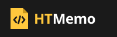
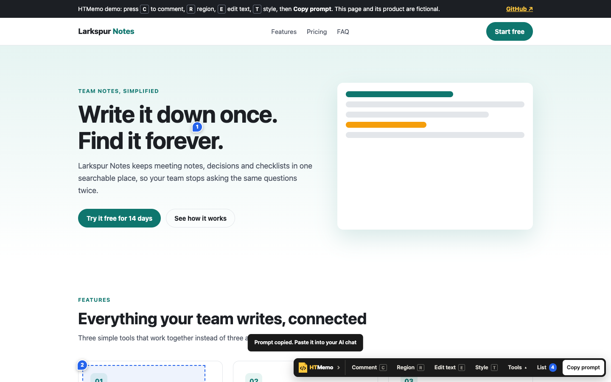

<p align="center"></p>

<p align="center"><b>English</b> · <a href="README.ko.md">한국어</a></p>

# HTMemo

A Claude Code plugin for reviewing web pages. Leave memos directly on the page, copy them as one prompt, and paste it back into Claude to apply the changes.

The toolbar that appears on the page is a single JavaScript file with no dependencies and no server. Click an element to comment, drag to mark an area, edit text in place, or tweak font size, spacing and colors with sliders. HTMemo groups everything by page section and copies a Markdown prompt that includes each element's CSS selector, the screen width it applies to, and the exact values to change.

**[Try the demo →](https://kkjjjy1b.github.io/htmemo/demo/)**



## Install (Claude Code plugin)

Run these two commands in Claude Code:

```text
/plugin marketplace add kkjjjy1b/htmemo
/plugin install htmemo
```

If another marketplace you added also has a plugin named `htmemo`, use `/plugin install htmemo@htmemo` instead. Restart Claude Code if it asks you to. To update later, run `/plugin marketplace update htmemo`.

## Use

1. **Add the toolbar.** Ask Claude in your project, for example: `Add HTMemo to index.html`. Claude inserts one script line before `</body>`:

   ```html
   <script src="https://cdn.jsdelivr.net/gh/kkjjjy1b/htmemo@v1.0.1/htmemo.js" defer></script>
   ```

2. **Review in the browser.** Open the page and leave memos with `C` (comment), `R` (region), `E` (edit text) and `T` (style).
3. **Copy prompt.** Press **Copy prompt** and paste it into Claude Code. Claude finds each element by its selector and applies the changes, scoping "Desktop only" / "Mobile only" items with media queries.
4. **Repeat.** Reload the page, mark finished items as **Done** in the list, and review again.
5. **Remove before release.** Ask Claude: `Remove HTMemo`. The toolbar is for review only and should not ship to visitors.

The copied prompt is plain Markdown, so it also works if you paste it into Claude.ai.

## Features and shortcuts

| Tool | Key | What it does |
|---|---|---|
| Comment | `C` | Click any element and write a change request. Quick chips like "Bigger" or "More space" help. |
| Region | `R` | Drag a box over an area and leave a note about it. |
| Edit text | `E` | Click text and edit it in place. The original and the new text are both recorded. |
| Style | `T` | Pick an element and adjust font size, weight, line height, letter spacing, padding, margin, gap, max width, text color and background with live preview. |
| List | `L` | See all memos by section, jump to one, mark it done or delete it. |
| Copy prompt | | Copy every open memo as a Markdown prompt. |
| Measure | `M` | Click a base element, then hover another to see the distance and edge offsets in px. |
| Grid | `G` | Overlay a 4 / 8 / 12 column grid on the content area (mobile / tablet / desktop). |
| Hide | `H` | Hide pins and overlays to see the page clean. |
| Width | | Preview the page at 375, 768 or 1440 px in the same window. Memos left there go to the same list. |
| Scope | `↑` `↓` | While commenting, styling or measuring, move the target to the parent element and back. |
| Close | `Esc` | Leave the current mode or close panels. |

Every memo can be set to apply to **All screens**, **Desktop only** or **Mobile only**, and records the screen width it was left at. Memos are saved in your browser's `localStorage` per page path, so they survive reloads. Nothing is sent anywhere.

Measure, Grid, Hide and Width live under the **Tools** button. Their shortcuts work even while it is closed.

### Example prompt

```markdown
# Design change requests (2026-11-18 16:54)
Page: Larkspur Notes · /demo/index.html · 2 requests
Paths (`…`) are CSS selectors. If "Applies to" is not "All screens", change only that screen size.

## Hero
1. Heading "Write it down once. Find it forever.": Bigger, tighten the line height
   - Applies to: All screens · Captured at: Desktop 1440px · `#top > div:nth-of-type(1) > div:nth-of-type(1) > h1:nth-of-type(1)`

## Simple plans for every team size
2. [Style tweak] Paragraph "$8 / member / month": Font size 40px → 48px, Text color #1c1f24 (var(--ink)) → #0f766e (var(--brand))
   - Applies to: All screens · Captured at: Desktop 1440px · `#pricing > div:nth-of-type(1) > div:nth-of-type(1) > div:nth-of-type(2) > p:nth-of-type(2)`
```

## Options

Ask Claude to add options when you need them, for example `HTMemo: the page has a 76px fixed bottom bar on mobile`. Options are `data-*` attributes on the script tag:

```html
<script src="https://cdn.jsdelivr.net/gh/kkjjjy1b/htmemo@v1.0.1/htmemo.js"
        data-lang="en" data-mobile-bottom="76" data-container=".container" defer></script>
```

or with a `window.HTMemo` object defined **before** the script loads:

```html
<script>
  window.HTMemo = { lang: 'ko', colors: ['#1a1a1a', '#2563eb', '#ffffff'], mobileBottom: 76 };
</script>
```

| Option (`data-` attribute) | Default | Description |
|---|---|---|
| `lang` (`data-lang`) | `auto` | `ko`, `en`, or `auto` (Korean if the browser language is Korean, otherwise English). |
| `bottom` (`data-bottom`) | `12` | Distance in px between the toolbar and the bottom of the screen. |
| `mobileBottom` (`data-mobile-bottom`) | same as `bottom` | Same, under 768 px. Raise it if your page has a fixed bottom bar. |
| `collapsed` (`data-collapsed`) | auto | `true` / `false` to force the starting state. By default the toolbar starts collapsed on mobile and remembers its last state on desktop. |
| `container` (`data-container`) | `.container, .wrapper, .wrap, .content, main` | Selector for the content area the grid aligns to. The first visible match wins; otherwise the full width is used. |
| `columns` (`data-columns`) | `4,8,12` | Grid columns for mobile, tablet, desktop. The gap comes from the `--grid-gap` CSS variable, `gridGap`, or 16px. |
| `breakpoints` (`data-breakpoints`) | `768,1080` | Tablet and desktop widths used for the grid and the "captured at" label. |
| `colors` (`data-colors`) | auto | Swatches in the Style panel. By default HTMemo collects color values from CSS custom properties on `:root` (for example `--brand`) and shows them by name. |
| `editable` (`data-editable`) | common text tags | Selector for elements that Edit text can change. |
| `storageKey` (`data-storage-key`) | page path | Key for saving memos. Set the same key on several URLs to share one list. |

Name a section yourself with `data-htmemo-section="Pricing"` on any element. Otherwise HTMemo uses the nearest `section`, `header`, `footer`, `nav` or `aside`, and its `aria-label`, `aria-labelledby`, first heading or `id`. A heading split with `<br>` is read as one line.

### JavaScript API

After loading, `window.HTMemo` has `version`, `lang`, `getPrompt()`, `getItems()`, `setMode('comment' | 'region' | 'edit' | 'tune' | 'measure' | 'view')` and `copyPrompt()`.

## Browser support and limits

- Recent Chrome, Edge, Safari and Firefox.
- Elements are found again by CSS `:nth-of-type` paths. If the page structure changes a lot, older pins may point to a different element or disappear.
- Copying uses the Clipboard API. On plain `http://` pages it falls back to an older copy method.
- The width preview loads the same page in an iframe, so it only works for pages that allow being framed by themselves.

## Roadmap

- Saving memos to a local file

## Development

```bash
python3 test/e2e.py
```

The end-to-end test uses Python Playwright with the installed Google Chrome (`pip install playwright`). Screenshots and the copied prompt are written to `test/out/`.

## License

[MIT](LICENSE)
